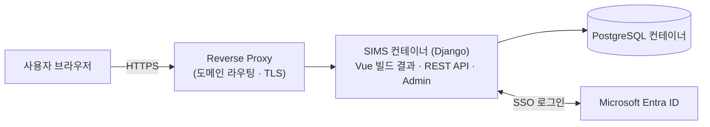
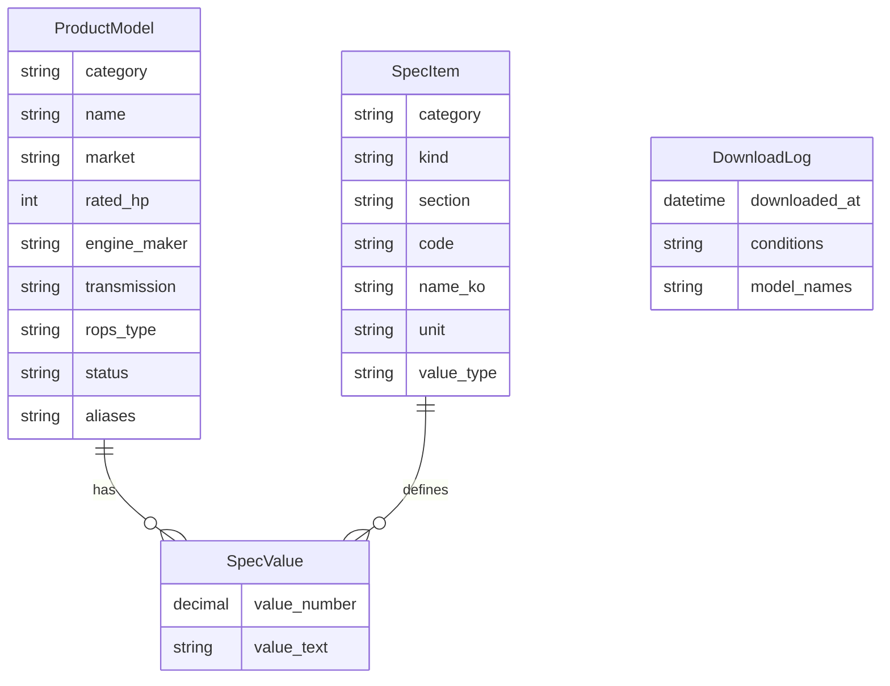
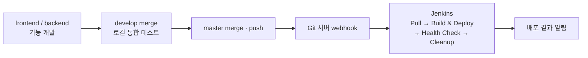

# SIMS — Specification Information Management System

> 사양 정보 관리 시스템 · 농기계 제조사 사내용 제품 사양 통합 조회 시스템


> **현재 단계**: 배포 파이프라인 검증 완료 → 데이터 모델 확정 → **Django 모델 구현 중**

---

## 1. 개요

트랙터·콤바인·이앙기·엔진 등 **본기**와 로더·백호·모어 등 **작업기**의 제품 사양을 하나의 DB로 통합하고, 임직원이 모델·국가별 최신 사양을 웹에서 조회할 수 있게 하는 사내 시스템입니다.

### 해결하려는 문제

| 문제 | 현재 상황 |
|---|---|
| 사양 원본 분산 | 부서·시장별로 관리되는 엑셀 파일 10여 종에 흩어져 있음 |
| 최신본 불명확 | 같은 모델의 수치가 파일마다 다르고, 어느 것이 최신인지 알기 어려움 |
| 다중 모델명 | 같은 제품이 판매처·시장·사내 코드에 따라 여러 이름으로 불리고, 이를 연결한 공식 표가 없음 |
| 표기 불일치 | 단위 혼용(ps/hp/kW, mm/inch), 국문·영문 항목명 혼용, 입력 오류 |
| 변경 추적 불가 | 누가 언제 어떤 값을 바꿨는지 이력이 없음 |

### 목표

- 사양 데이터를 **단일 DB(Single Source of Truth)** 로 통합
- 국가·마력·엔진 조건 조회, 모델 간 비교, 단위 자동 변환
- 사내 표준 제품 코드 체계에 맞춘 데이터 구조
- 사내 SSO(Microsoft 계정) 로그인, 모든 변경 이력 기록

---

## 2. 주요 기능 (1차: 트랙터)

- **조건 조회**: 국가·마력·엔진 드롭박스 AND 조건으로 모델 검색
- **검색 필터**: 판매 모델명뿐 아니라 사내 코드·판매처 모델명(별칭)으로도 검색
- **모델 비교**: 2~10개 모델의 사양을 나란히 비교, 값이 다른 항목 강조
- **단위 전환**: metric ↔ imperial 즉시 전환 (DB에는 metric만 저장)
- **엑셀 다운로드**: 조회·비교 결과 다운로드 (다운로드 기록 + 파일 내 다운로드자·일시 표기)
- **데이터 관리**: Django Admin에서 사양 수정, 변경 이력 조회·복원
- **데이터 이관**: 기존 엑셀 → DB 이관 스크립트 + 오류 검증 리포트

2차 이후: 옵션(기본/선택 사양), 콤바인·이앙기·엔진, 작업기(작업기 ↔ 트랙터 적합 정보)

---

## 3. 기술 스택

| 구분 | 기술 | 선택 이유 |
|---|---|---|
| Backend | Python 3.13, Django 6.1, Django REST Framework | 사내 표준 프레임워크, Django Admin으로 관리 화면 개발 비용 절감 |
| Frontend | Vue 3, Vite, Vue Router, Pinia, axios, scoped CSS | 비교·전환 등 새로고침 없는 상호작용이 핵심 |
| Database | PostgreSQL | 다수 사용자 동시 조회, 관계형 구조에 적합 |
| WSGI | Waitress | 사내 기존 시스템과 동일 |
| Auth | django-allauth + Microsoft Entra ID (단일 테넌트) | 사내 계정 SSO, 퇴사 시 접근 자동 차단 |
| Audit | django-simple-history | 변경자·시점·전후 값 기록, Admin에서 복원 |
| Static | WhiteNoise | Vue 빌드 결과를 Django가 직접 서빙 |
| Data Migration | pandas, openpyxl | 형식이 제각각인 엑셀을 정규화하여 이관 |
| Infra | Docker 멀티스테이지 빌드, Docker Compose, Reverse Proxy | 컨테이너 기반 배포 |
| CI/CD | Git 서버 webhook + Jenkins | `master` push 시 자동 빌드·배포 |

---

## 4. 아키텍처



- **컨테이너 2개**: 애플리케이션(Django가 Vue 정적 파일·API·Admin을 함께 제공) + PostgreSQL
- **멀티스테이지 빌드**: Docker 빌드 단계에서 Node로 Vue를 빌드하고, 결과물만 Python 이미지에 복사
- **포트 비노출**: 애플리케이션 포트는 외부에 열지 않고 리버스 프록시를 통해서만 접근 (현재 테스트 단계에서만 임시 노출)

---

## 5. 데이터 모델

### 5-1. 핵심 아이디어

> **"무엇을 재는지(항목)"와 "얼마인지(값)"를 분리하고, 저장은 세로(long)로, 화면은 가로(wide)로.**

기종마다 사양 항목 구성이 완전히 다르기 때문에(트랙터 56개, 로더 약 30개, 모어는 또 다름), 항목을 컬럼으로 고정하지 않고 **항목 사전 + 값 테이블** 구조를 씁니다. 기종이 늘어도 테이블은 늘지 않습니다.



| 테이블 | 역할 |
|---|---|
| **ProductModel** | 모델 1개 = 1줄. 사내 표준 기종 구분 단위(국가·출력·엔진·변속·ROPS 조합)를 따름 |
| **SpecItem** | 항목 사전: 섹션, 국문·영문명, 저장 단위, 숫자/텍스트, 표시 순서 |
| **SpecValue** | 모델 × 항목 = 값 |
| **DownloadLog** | 엑셀 다운로드 기록 (보안) |

### 5-2. 설계 규칙

- **조회에 쓰는 값은 컬럼, 보여주는 값은 SpecValue**: 국가·마력·엔진·변속·ROPS는 모델의 정체성이자 드롭박스 필터라 ProductModel 컬럼으로 둠
- **모델명 접미사 규칙**: 기본 사양(변속·ROPS·국가 등)이 다르면 별도 줄, 옵션만 다르면 같은 줄
- **metric만 저장**: 출력은 kW, 길이는 mm. ps·hp·inch는 화면에서 변환
- **값이 없으면 줄을 만들지 않음**: 화면에서 "-" 표시
- **한 칸에 두 값이면 항목 분리**: 좌/우 회전반경 → 항목 2개

필드 상세는 [`docs/DATA_MODEL.md`](docs/DATA_MODEL.md) 참고.

---

## 6. 개발 · 배포 흐름



| 구간 | 수행 | 비고 |
|---|---|---|
| 개발 → `master` push | 수동 | 운영 환경이 1개라 **merge 전 로컬 통합 테스트가 유일한 검증 단계** |
| push 이후 | 자동 | 이미지 빌드, 컨테이너 교체, 컨테이너 시작 시 DB migrate 자동 실행 |

---

## 7. 프로젝트 구조

```text
Specification-Information-Management-System/
├── BackEnd/
│   ├── requirements.txt       # Python 패키지 (버전 고정)
│   └── sims/                  # Django 프로젝트 루트 (manage.py)
│       ├── sims/              # 프로젝트 설정
│       ├── accounts/          # 로그인·사용자
│       └── specs/             # 사양 데이터 (예정)
├── FrontEnd/
│   └── sims/                  # Vue 3 + Vite 프로젝트 루트
├── docs/
│   └── DATA_MODEL.md          # 데이터 모델 상세
├── Dockerfile                 # 멀티스테이지 빌드 (Node → Python)
├── docker-compose.yml         # app + PostgreSQL (비밀값은 .env로 주입)
├── .env.example               # 환경 변수 목록 (값 없음)
├── .dockerignore
├── .gitignore
├── CLAUDE.md                  # Claude Code 작업 규칙
└── README.md
```

> 배포 파이프라인 스크립트는 저장소가 아닌 Jenkins Job 내부에서 관리합니다.

---

## 8. 로컬 개발 환경

```bash
# 1) 가상환경 (최초 1회 생성)
cd BackEnd
python -m venv venv
source venv/Scripts/activate        # Windows Git Bash  (macOS/Linux: source venv/bin/activate)
pip install -r requirements.txt

# 2) Django (로컬에서는 DEBUG를 켜고 실행)
export DJANGO_DEBUG=True
cd sims
python manage.py migrate
python manage.py runserver

# 3) Vue (별도 터미널)
cd FrontEnd/sims
npm install
npm run dev
```

전체 구성(app + DB)은 저장소 루트에서 `.env`를 만든 뒤 `docker compose up -d --build`로 실행합니다.

---

## 9. 보안 고려사항

사양 데이터는 대외비이므로, 외부 접근 경로가 열리는 상황까지 전제하고 설계합니다.

- **단일 테넌트 SSO**: 회사 Microsoft 계정만 로그인 허용
- **전 경로 인증 필수**: 조회 화면·API·Admin 모두 로그인 없이 접근 불가
- **비밀값 분리**: DB 비밀번호, SSO Secret, Django Secret Key는 서버 `.env`로만 관리. `DEBUG=False`인데 Secret Key가 없으면 기동 단계에서 실패하도록 구성
- **데이터 유출 방지**: 실제 사양 데이터(엑셀·DB 덤프)와 사내 문서는 `.gitignore`로 저장소에서 원천 차단
- **엑셀 다운로드 추적**: 다운로드 기록 + 파일 내 다운로드자·일시·대외비 표기
- **데이터 보호**: 이관 후 DB가 유일한 원본이 되므로 오픈 전 정기 백업 구축

---

## 10. 브랜치 전략 · 커밋 컨벤션

| 브랜치 | 용도 |
|---|---|
| `master` | 운영 배포 (push 시 자동 배포) |
| `develop` | 통합 개발, 배포 전 로컬 테스트 |
| `frontend` | 프론트엔드 작업 |
| `backend` | 백엔드 작업 |

커밋 접두어: `feature:` `fix:` `docs:` `refactor:` `chore:`

---

## 11. 로드맵

- [x] 요구사항 정의 및 기술 스택 결정
- [x] 원본 사양 데이터 구조 분석 (엑셀 10여 종)
- [x] 사내 제품 코드 체계 조사 (제품군 → 제품코드 → 기종 구분 → 주문 사양)
- [x] 아키텍처·배포 구조 설계 및 검토
- [x] **Hello SIMS**: 빈 프로젝트로 배포 파이프라인 검증 (push → 자동 빌드·배포 성공)
- [x] 데이터 모델 확정 (세로 테이블 4개)
- [ ] Django 모델 구현 + Admin 등록
- [ ] PostgreSQL 연결, 비밀값·`DEBUG=False` 적용
- [ ] 엑셀 → DB 이관 스크립트 + 오류 검증 리포트
- [ ] 조회 API (DRF)
- [ ] 조회 화면 (조건 조회, 비교, 단위 전환, 엑셀 다운로드)
- [ ] SSO 로그인 · 권한 · 변경 이력
- [ ] DB 정기 백업 구축
- [ ] 트랙터 MVP 오픈
- [ ] 옵션 데이터 · 전 기종 확장

---

## 12. 주요 설계 결정 기록

| 결정 | 검토한 대안 | 선택 이유 |
|---|---|---|
| Django + Vue 분리형 | Django 템플릿만 사용 | 비교·전환 중심 UX에 화면 반응성이 중요 |
| 단일 저장소(Monorepo) | 프론트·백엔드 저장소 분리 | 기능 하나가 양쪽에 걸쳐도 커밋·배포를 한 번에 |
| 단일 컨테이너 + WhiteNoise | 프론트 전용 웹서버 컨테이너 | 사내 기존 시스템과 동일한 구조로 유지보수 일관성 확보 |
| Django Admin으로 관리 화면 | Vue로 관리 화면 별도 개발 | 수정 인원이 소수라 개발량 대비 이득이 큼 |
| **세로 테이블 4개** | ① 정규화 테이블 9개 ② JSON 필드 ③ 기종별 넓은 테이블 | ① 이 규모엔 과함 ② Admin에서 수정이 불편하고 오타를 DB가 못 막음 ③ 기종이 늘 때마다 테이블·화면 코드 복제. 세로 테이블은 Admin inline으로 항목별 수정이 쉽고, 기종이 늘어도 구조 그대로 |
| 기종·시장·엔진은 컬럼으로 | 각각 별도 테이블 | 거의 바뀌지 않는 짧은 목록이라 테이블로 나눌 이득이 없음 |
| 사내 표준 기종 구분 단위를 모델의 기준으로 | 판매 모델명 기준 | 같은 판매명이라도 국가·변속·캐빈에 따라 사양이 다름. 사내 표준과 맞추면 다른 시스템과 연결이 쉬움 |
| metric만 저장 | metric·imperial 모두 저장 | 이중 저장 시 값이 어긋나는 문제가 원본에서 이미 발생 |
| 출력은 kW로 저장 | ps 저장 | ps·hp 모두 kW에서 정확히 변환 가능, 원본의 ps/hp 라벨 혼용 문제 차단 |
| 사내 인프라 관례 준수 | 새로운 최적 구조 도입 | 2인 유지관리 체계에서는 프로젝트 간 일관성이 가장 큰 가치 |

---

© 2026. All rights reserved. 사양 데이터와 사내 정보는 이 저장소에 포함되어 있지 않습니다.
