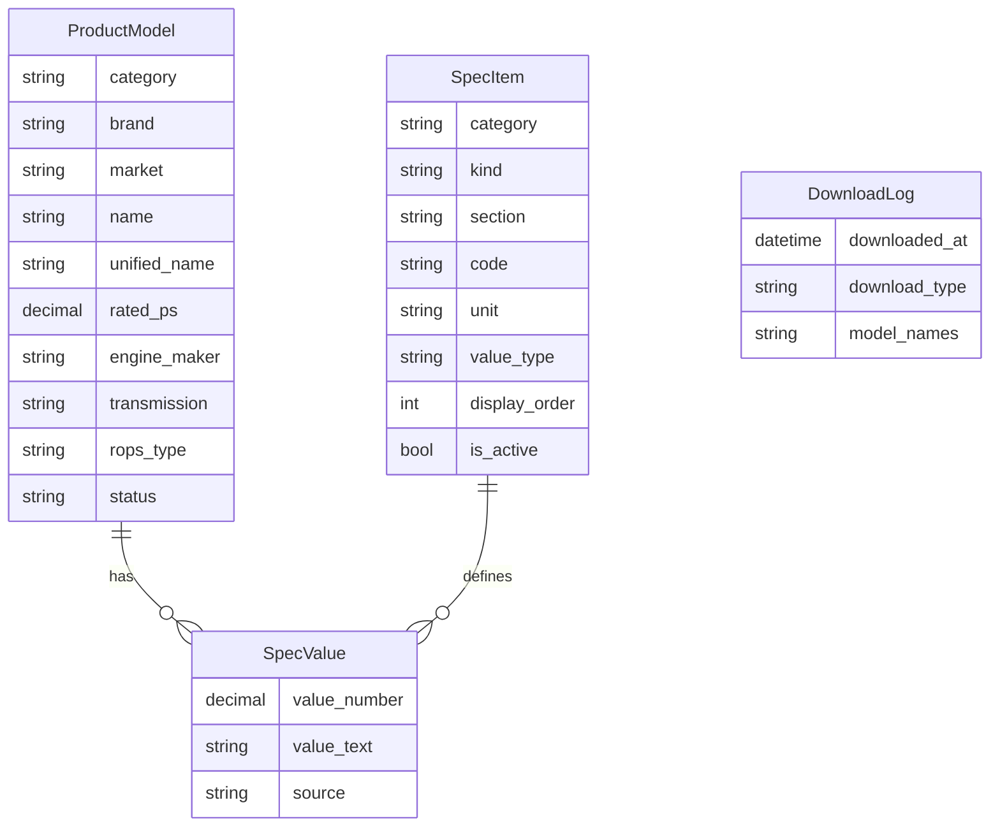

# SIMS 데이터 모델 (공개용 요약)

> 이 문서는 공개 저장소용 요약본이다. 사내 코드 값·원본 파일명·실제 모델 데이터는 포함하지 않는다.
> 실제 구현의 기준 문서(사내 코드 포함)는 사내 저장소에서 관리한다.

---

## 1. 설계 전제

- 사양 데이터의 수정·신규 입력은 **드물다.** 속도보다 **정확성과 추적 가능성**이 중요하다.
- 단순 조회 시스템이다. 가장 무거운 화면(모델 10개 비교)도 수백 줄 수준이라 별도 최적화는 하지 않는다.
- 원칙: **같은 값을 두 곳에 저장하지 않는다.** 다른 칸에서 계산할 수 있는 값은 저장하지 않고 property로 계산한다.

## 2. 전체 구조

- 앱 하나(`specs`)에 테이블 4개. 선택지는 `choices.py` 한 곳에서 정의해 모든 테이블이 같이 쓴다.
- 저장은 세로(항목당 1줄), 화면은 가로(pivot).
- 변경 이력(django-simple-history): ProductModel, SpecItem, SpecValue.

## 3. ProductModel (모델 1개 = 1줄)

한 줄 = **사내 표준 기종 구분 단위**(시장·엔진·변속·보호구조물 조합). 이 요소가 다르면 별도 줄, 타이어 등 옵션만 다르면 같은 줄.

| 그룹 | 필드 |
|-|-|
| 이름 | `category`(기종), `brand`(판매처), `name`(판매명), `unified_name`(통합 모델명), `model_type_name`(형식명), `aliases`(별칭, 쉼표 구분) |
| 기종 구분 요소 | `market`, `rated_ps`(마력, 소수), `engine_maker`, `engine_model`, `transmission`, `rops_type` |
| 상태·외부 코드 | `status`(개발/양산/단종), `mi_code`(사내 기종 구분 코드), `d365_item_codes`(ERP 품목 코드, 쉼표 구분) |
| 관리 | `note`, `created_at`, `updated_at` |

- **중복 금지**: 기종 + 시장 + 판매처 + 판매명 + 변속 + 보호구조물
- 선택지 값은 **사내 표준 코드를 그대로** 저장해, 사내 기종 구분 코드의 자리별 값과 자동 대조한다 (`clean()`)
- **"모름"은 빈 문자열로 저장, NULL 금지**: PostgreSQL은 NULL끼리 다른 값으로 봐서 중복 기준이 무력화된다
- 계산 속성(저장 안 함): 제품 코드(기종 구분 코드 앞부분), 시리즈(통합 모델명에서), 마력대(`rated_ps` 10 단위 내림)
- 모델은 삭제하지 않고 "단종" 처리. 삭제는 최고 관리자만 (값이 함께 지워지므로)

## 4. SpecItem (항목 사전)

| 필드 | 설명 |
|-|-|
| `category`, `kind` | 기종, 사양/옵션 구분 |
| `section`, `display_order` | 화면 묶음과 순서 (섹션 순서도 `display_order`로 결정) |
| `code` | 영문 소문자_밑줄. **한 번 정하면 바꾸지 않는다** |
| `name_ko`, `name_en` | 화면 표시명 |
| `unit` | 저장 단위 (선택지, metric) |
| `value_type` | 숫자 / 텍스트 |
| `source_label` | 원본 엑셀의 행 이름. 파일마다 표기가 다르면 `|`로 여러 개 |
| `source_code` | 원천 시스템 옵션 코드 (옵션일 때) |
| `is_active` | 안 쓰는 항목은 삭제 대신 숨김 (값이 있는 항목은 삭제 불가) |

- 중복 금지: 기종 + 코드
- 단위를 바꾸면 모든 모델의 값 해석이 바뀌므로 변경 이력 적용

## 5. SpecValue (모델 × 항목 = 값)

| 필드 | 설명 |
|-|-|
| `product_model` | 모델 (CASCADE) |
| `spec_item` | 항목 (**PROTECT**: 값이 있는 항목은 삭제 불가) |
| `value_number` | 숫자값 (`DecimalField`: 실수 오차 없이) |
| `value_text` | 텍스트값 |
| `source` | 출처 (선택지: 원본 사양표 / 제품사양서 / 수기 입력 / 기타) |
| `note` | 원본 불일치 처리 등 메모 |

**검증 5개** (저장 시 자동)

| 규칙 | 막는 실수 |
|-|-|
| 모델 + 항목 조합 중복 금지 | 같은 값 두 번 입력 |
| 숫자 항목엔 숫자값만, 텍스트 항목엔 텍스트값만 | 숫자 칸에 단위 붙은 글자 |
| 둘 다 비어 있으면 저장 불가 | 빈 줄 |
| 모델의 기종 = 항목의 기종 | 트랙터에 작업기 항목 연결 |
| 사용 안 함 항목에 새 값 금지 | 숨긴 항목에 실수로 입력 |

## 6. DownloadLog (엑셀 다운로드 기록)

`user`(SET_NULL), `user_name`·`user_email`(당시 스냅샷), `downloaded_at`, `download_type`(조회/비교/상세), `conditions`, `model_names`(당시 스냅샷).

- 이름·모델명을 텍스트 스냅샷으로 저장: 나중에 바뀌거나 삭제돼도 "그때 무엇을 받았는지"가 남아야 한다
- Admin은 조회 전용 (최고 관리자 포함 수정·삭제 불가)

## 7. 단위 변환 (화면에서 계산)

저장 단위는 metric 하나. 출력은 kW로 저장하고 ps·hp는 화면에서 계산한다.

| 저장 | 표시 | 변환 |
|-|-|-|
| kW | ps / hp | × 1.35962 / × 1.34102 |
| mm / m | in / ft | ÷ 25.4 / × 3.28084 |
| kg | lb | × 2.20462 |
| N·m | lbf·ft | × 0.737562 |
| L / cc | gal / cu.in | ÷ 3.78541 / ÷ 16.3871 |
| L/min | gpm | ÷ 3.78541 |
| km/h | mph | ÷ 1.60934 |
| bar / MPa | psi | × 14.5038 / × 145.038 |

## 8. 이관 원칙

- 이중 표기(`24.6 ps | 18.4 kW`) → metric 값만 저장
- `-`, N/A, 빈칸 → 값을 만들지 않음 (화면에서 "-")
- 한 칸에 두 값(좌/우, 최소/최대) → 항목을 나눠 저장
- 기종 구분 요소(엔진·변속·마력)는 값 테이블이 아니라 모델 컬럼으로
- dry-run에서 오류 0건일 때만 저장, 같은 원본으로 재실행해도 결과가 같도록(idempotent)

## 9. 나중에 추가할 것

| 항목 | 시점 |
|-|-|
| 작업기 ↔ 트랙터 적합 정보 테이블 (기존 테이블 변경 없이 추가) | 작업기 확장 시 |
| 콤바인·이앙기 조수 필터 컬럼 | 해당 기종 추가 시 |
